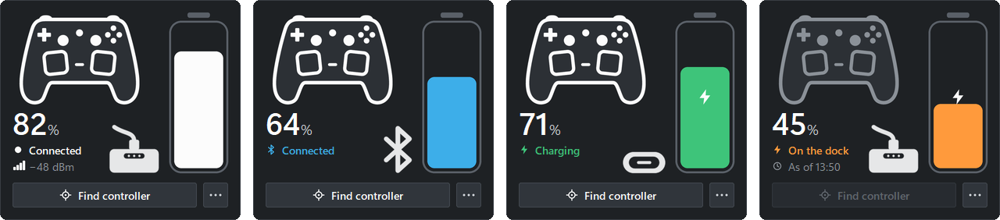

# controller-windows-widget

A Windows 11 system tray widget for the **Steam Controller 2** (2026): battery
level, charging state, link type (wireless puck, Bluetooth or USB-C), puck
signal strength and an estimate of the time left, one click away.



It is a Windows port of
[steam-controller-plasma-widget](https://github.com/jahrekza/steam-controller-plasma-widget)
by jahrekza: the reverse-engineered HID protocol and the artwork come from that
project (MIT, see [NOTICE.md](NOTICE.md)).

The interface is available in English and Spanish. It follows the Windows
display language (Spanish for any Spanish locale, English otherwise), and
can be switched from the menu.

## Features

- **Tray icon**: a level bar that follows the battery, coloured for charging,
  low battery and disconnected states.
- **Flyout panel** (left click): the Plasma widget's card at 130 %, with the
  controller illustration, the battery level in big type, a vertical battery
  coloured like the controller's LED (white on the puck, blue on Bluetooth,
  green on USB-C, orange when charging off on the dock, red when low), the link
  icon and the puck's signal (bars and dBm). The card keeps the same height in
  every state. It closes on a click outside or with Esc.
- **Find my controller**: pulses the controller's haptics, or plays a tune on
  them (tick-tock, bird, ringing, SOS, alarm), so you can locate it.
- **Tooltip**: level, charging state, link, signal and time left.
- **Context menu** (right click): find the controller, low battery / charge
  complete / disconnect notifications, start with Windows and language.
- **Works alongside Steam**: HID reads are shared, so Steam keeps working.
- Battery history for the last 24 hours, used for the time-left estimate.

## Requirements

- Windows 10 or 11.
- A Steam Controller 2 linked through its puck, the Steam Machine's built-in
  receiver, Bluetooth or a USB-C cable.
- Python 3.10 or newer to run from source (the standalone `.exe` needs none).

## Running from source

```powershell
python -m venv .venv
.\.venv\Scripts\pip install -e .[dev]
.\.venv\Scripts\pythonw -m sc2tray              # tray icon
.\.venv\Scripts\python -m sc2tray --headless    # print the state as JSON
.\.venv\Scripts\python -m sc2tray --find ticktock
```

Settings are stored in `%APPDATA%\SC2Tray\config.json` and the battery history
in `%LOCALAPPDATA%\SC2Tray\history.json`.

## Standalone executable

```powershell
.\.venv\Scripts\python tools\build_exe.py
```

This builds `dist\SC2Tray.exe`, a single file of about 20 MB that does not need
Python. Copy it anywhere and turn on "Start with Windows" from its menu. The
autostart entry points at the `.exe`, so turn it on again if you move the file.
`--find` works with the `.exe` as well; `--headless` does not, since the `.exe`
has no console.

## How it works

Windows splits every interface of the puck (`28de:1304`) into collections:
mouse and keyboard, which the system holds exclusively, and a **vendor
collection (usage page `0xFF00`)** that carries the reports this app needs. A
linked controller shows up on one of the slots MI_02 to MI_05; MI_06 is the
charging dock.

| Report | Bytes used |
|---|---|
| `0x43` battery | `[1]` 1 discharging · 2 charging · 3 validating · 4 full; `[2]` level in % |
| `0x7b` radio | `[9]` signal in signed dBm (puck links only) |
| feature `0x02`, command `0xB4` (MI_06) | answer `02 b4 01 <2 = on the dock>` |

The other product IDs are `28de:1302` (USB-C), `28de:1303` (Bluetooth) and
`28de:1305` (the Steam Machine's built-in receiver).

## Project layout

| Path | Purpose |
|---|---|
| `src/sc2tray/protocol.py` | IDs, `0x43`/`0x7b` decoding, dock query, haptic reports (pure, no I/O) |
| `src/sc2tray/device.py` | hidapi: the live vendor collection, the dock (MI_06), "find my controller" |
| `src/sc2tray/monitor.py` | reader thread and dock polling, producing a `ControllerState` |
| `src/sc2tray/state.py` | state, time-left estimate, history |
| `src/sc2tray/icons.py` | the tray icon, drawn with Pillow |
| `src/sc2tray/tray.py` | pystray: icon, tooltip, menu, notifications |
| `src/sc2tray/panel.py` | the flyout panel (tkinter and Pillow) |
| `src/sc2tray/text.py` | tooltip, menu and panel wording |
| `src/sc2tray/i18n.py` | English and Spanish strings, system language detection |
| `src/sc2tray/config.py` | settings, autostart (HKCU Run), single instance, theme |
| `src/sc2tray/assets/` | PNG masks of the panel's icons, tinted at runtime |
| `assets/upstream/` | the original SVG artwork of the Plasma widget (MIT) |
| `tools/hid_probe.py` | lists the HID collections and samples their reports (diagnostics) |
| `tools/build_exe.py` | builds the app icon and runs PyInstaller to make `dist\SC2Tray.exe` |
| `tools/import_icons.py` | copies the upstream SVGs and rasterizes them to masks (resvg-py, development only) |

## Tests

```powershell
.\.venv\Scripts\python -m pytest
```

## License

[MIT](LICENSE). The HID protocol knowledge and the artwork come from
steam-controller-plasma-widget, also MIT; see [NOTICE.md](NOTICE.md).

This project is not affiliated with or endorsed by Valve. Steam and Steam
Controller are trademarks of Valve Corporation.
